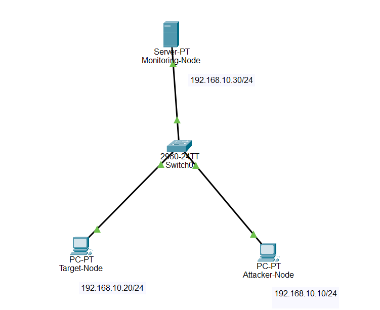

# TEK1314 — Proyek PBL Keamanan Siber: GeoSync IoT Backend Replika (Kelompok 1 - A1)

Repositori ini merupakan artefak lengkap **Fase 1 hingga Fase 3 (Minggu 1–15)** untuk mata kuliah **TEK1314 - Keamanan Siber** (Program Studi D4 Teknologi Rekayasa Komputer, Sekolah Vokasi IPB University).

Proyek ini membangun, mengamankan (*hardening*), menguji (*Purple Team Loop*), dan menganalisis insiden keamanan mengacu standar **NIST SP 800-61r2** pada **Backend Replika Sistem IoT GeoSync** (Modul Traktor Pertanian Otonom dengan kendali pembakaran awal *auto-crank* & dekompresi elektronik, manajemen termal mesin otomatis, serta pemetaan lintasan pembajakan lahan berbasis **Full Firebase Realtime Database**).

> **Prinsip Etika & Keamanan Lab:** Seluruh simulasi serangan, video demo, dan analisis laporan akhir dijalankan sepenuhnya pada **Target-Node Replika (`192.168.10.20`)** di jaringan laboratorium terisolasi (`intnet-pbl`) menggunakan data sintetis/dummy, tanpa menyentuh perangkat keras traktor otonom GeoSync asli milik Mitra.

---

## Anggota Kelompok 1 (Kelas A1)

| Nama | NIM | Peran (Role) | Tanggung Jawab Utama |
|---|---|---|---|
| **Tahra Aulia** | J0404241063 | **Lead / Coordinator** | Koordinasi penyusunan Incident Report final, slide presentasi, konsistensi Red/Blue Team, dan kelengkapan artefak GitHub |
| **Bagas Aditya Putra Rinaldi** | J0404241080 | **Blue Team (Defender & Backend)** | Pengembangan aplikasi backend replika GeoSync (Flask + Firebase RTDB), hardening Kategori A/B/C, UFW, Fail2ban, & Nginx Rate-Limit |
| **Muhammad Raka Faqihhudin** | J0404241159 | **Blue Team (SOC & Network)** | Pemantauan trafik jaringan dengan Security Onion (`tcpdump`, `so-import-pcap`, Sguil), analisis log forensik, dan korelasi alert IDS |
| **Farrel Naufal Fatih** | J0404241083 | **Red Team (Attacker)** | Perancangan dan eksekusi skenario serangan (`attack_plan.md`) serta pengujian ulang pasca-mitigasi (Tahap 5 Purple Team Loop) |

---

## Tautan Cepat Artefak Utama (Fase 1 – Fase 3)

### Fase 3 — Penutupan Siklus (Minggu 14 & 15)
* **Final Incident Report (NIST SP 800-61r2):** [`docs/final/incident_report.md`](docs/final/incident_report.md) *(atau versi PDF `docs/final/incident_report.pdf`)*
* **Slide Presentasi Final (PDF):** [`docs/presentation-final/slides.pdf`](docs/presentation-final/slides.pdf)
* **Video Demo Purple Team Loop (5–8 Menit):**
  * **Tautan Video Demo (Google Drive / YouTube Unlisted):** *[Tautan Video Demo akan diperbarui di sini setelah proses render selesai]* (atau berkas [`docs/final/video_demo.mp4`](docs/final/)).

### Fase 2 — Hardening, Simulasi Serangan & Purple Team Loop (Minggu 9 – 13)
* **Log Lengkap Purple Team Loop (Tahap 1–5):** [`docs/purple-team-log.md`](docs/purple-team-log.md)
* **Checklist Hardening Baseline & Remediasi (Kategori A/B/C):** [`docs/blueteam/hardening_checklist.md`](docs/blueteam/hardening_checklist.md)
* **Detail Pengujian Hardening Kategori A (PAM & Access Control):** [`docs/blueteam/hardening_kategori_A.md`](docs/blueteam/hardening_kategori_A.md)
* **Detail Pengujian Hardening Kategori B (UFW, Patching & Service Hardening):** [`docs/blueteam/hardening_kategori_B.md`](docs/blueteam/hardening_kategori_B.md)
* **Direktori Bukti Blue Team:** [`docs/blueteam/evidence/`](docs/blueteam/evidence/)
* **Rencana Serangan Red Team (Attack Plan):** [`docs/redteam/attack_plan.md`](docs/redteam/attack_plan.md)
* **Direktori Bukti Red Team:** [`docs/redteam/evidence/`](docs/redteam/evidence/)

### Fase 1 — Desain Arsitektur & Aplikasi Backend Replika (Minggu 1 – 8)
* **IP Plan & Pemetaan Tech Stack Asli ke Replika:** [`docs/design/ip_plan.md`](docs/design/ip_plan.md)
* **Diagram Topologi Jaringan Lab (`intnet-pbl`):** [`docs/design/topology.png`](docs/design/topology.png)
* **Dokumentasi Instalasi VM Lab & Security Onion:** [`docs/DOKUMENTASI_INSTALASI_UTAMA/`](docs/DOKUMENTASI_INSTALASI_UTAMA/) & [`docs/DOKUMENTASI_INSTALASI_BACKUP/`](docs/DOKUMENTASI_INSTALASI_BACKUP/)
* **Source Code Aplikasi GeoSync Backend Replika:** [`backend-replika/`](backend-replika/) (Panduan setup & daftar endpoint API: [`backend-replika/README.md`](backend-replika/README.md))

---

## Ringkasan Arsitektur & Topologi Lab (`intnet-pbl`)



| Node | Hostname | Role | IP Address | Sistem Operasi | Layanan & Fungsi Utama |
|---|---|---|---|---|---|
| **Attacker-Node** | `kali` | Red Team | `192.168.10.10/24` | Kali Linux | Eksekusi reconnaissance (`nmap`), brute-force SSH (`hydra`), dan eksploitasi API/Web (`curl`) |
| **Target-Node** | `kelompok1` | Target Server Replika | `192.168.10.20/24` | Ubuntu Server 22.04 | OpenSSH (`22/tcp`), Nginx Reverse Proxy (`80/tcp` -> Flask `127.0.0.1:5000`), UFW, Fail2ban, PAM `pwquality`, koneksi NAT HTTPS ke **Firebase RTDB Cloud** |
| **Monitoring-Node** | `seconion` | Blue Team (IDS / SIEM) | `192.168.10.30/24` | Security Onion | Promiscuous capture (`eth0`), `tcpdump`, `so-import-pcap`, Suricata/Snort IDS, analisis alert di **Sguil Console** |

---

## Ringkasan Hasil Purple Team Loop (Skenario 1 – 3)

| Skenario Serangan | Vektor Serangan (Red Team) | Deteksi IDS & Log (Blue Team) | Kontrol Mitigasi yang Diterapkan | Hasil Verifikasi Ulang (Tahap 5) |
|---|---|---|---|---|
| **1. Network & Service Reconnaissance** (`T1046`) | `nmap -sS -sV -O` & `nmap -p-` ke `192.168.10.20` | Alert Sguil `ET SCAN Nmap Scripting Engine` & `Suspicious inbound` | UFW `default deny incoming` (hanya allow `22/tcp` & `80/tcp`), isolasi Flask di `127.0.0.1:5000`, dan Nginx `server_tokens off;` | Hanya port `22` & `80` yang `open` (port `5000` tertutup); header `curl -I` hanya menampilkan `Server: nginx` tanpa versi |
| **2. SSH Credential Brute-Force** (`T1110.001`) | `hydra -l bagas -P pass.txt ssh://192.168.10.20 -t 4 -V` | Sguil **Alert ID `5.1278`** (`ET SCAN LibSSH Based Frequent SSH Connections Likely Brute Force`) & `/var/log/auth.log` | `PermitRootLogin no`, PAM `libpam-pwquality` (`minlen=10`, huruf besar/kecil/angka/simbol), & **Fail2ban** `sshd` (`maxretry=3`, `bantime=600`) | Percobaan Hydra ke-4 langsung diputus; `fail2ban-client status sshd` menampilkan `Banned IP list: 192.168.10.10` |
| **3. Web & IoT API Exploitation** (`T1190` / `T1110`) | `curl` POST `/api/telemetry` tanpa API key, injeksi suhu anomali `999 C`, & loop brute-force POST `/login` | Log systemd `journalctl -u backend` (`[SUSPICIOUS]`, `[AUTH-FAIL]`), Nginx `access.log`, & Sguil `ET POLICY curl User-Agent` | Isolasi secret `.env` (`chmod 600`), validasi `secrets.compare_digest`, rentang fisik `TELEMETRY_RULES`, RBAC Firebase (`user` vs `admin`), & Nginx `limit_req_zone` (`5r/m`, `burst=3 nodelay`) di `/login` | Request tanpa key ditolak (`401`), suhu `999 C` ditolak (`400`), loop 8x `/login` menghasilkan `401` x4 lalu diblokir Nginx (`503` x4), sedangkan telemetri valid tetap `201 Created` |

---

## Struktur Direktori Repositori

```text
TEK1314-2026-Kel1-A1/
├── README.md                                  # Ringkasan akhir proyek & tautan seluruh artefak Fase 1-3
├── backend-replika/                           # Source code aplikasi GeoSync IoT Backend Replika
│   ├── app.py                                 # Server Flask + integrasi Firebase Realtime Database + kontrol Kategori C
│   ├── requirements.txt                       # Dependensi Python (Flask, firebase-admin, python-dotenv)
│   ├── .env.example                           # Contoh template variabel lingkungan (tanpa kredensial asli)
│   ├── .gitignore                             # Mengabaikan .env, serviceAccountKey.json, venv, dan cache
│   ├── README.md                              # Dokumentasi teknis instalasi & daftar endpoint API backend
│   └── templates/
│       ├── login.html                         # Halaman login GeoSync Control Center
│       └── dashboard.html                     # Dashboard monitoring telemetri & kendali multi-role (User/Admin)
└── docs/
    ├── design/                                # Artefak Minggu 4 & 9 (Desain & Topologi)
    │   ├── ip_plan.md                         # Tabel IP Plan, pembagian peran, & pemetaan tech stack asli ke replika
    │   ├── topology.png                       # Diagram topologi jaringan virtual lab intnet-pbl
    │   └── Topology_Kel,1.png                 # Berkas diagram topologi asli
    ├── blueteam/                              # Artefak Minggu 9-13 (Blue Team / Defender)
    │   ├── hardening_checklist.md             # Checklist lengkap 14 kontrol Kategori A, B, dan C (Before vs After)
    │   ├── hardening_kategori_A.md            # Laporan pengujian PAM pwquality & akses direktori /opt/shared-data
    │   ├── hardening_kategori_B.md            # Laporan konfigurasi UFW, unattended-upgrades, & service hardening
    │   └── evidence/                          # Direktori bukti deteksi & verifikasi Blue Team
    │       └── README.md
    ├── redteam/                               # Artefak Minggu 9-13 (Red Team / Attacker)
    │   ├── attack_plan.md                     # Rencana & detail 3 skenario serangan Red Team
    │   └── evidence/                          # Direktori bukti eksekusi serangan Red Team
    │       └── README.md
    ├── purple-team-log.md                     # Log lengkap Siklus Purple Team Loop (Tahap 1-5) untuk 3 skenario
    ├── final/                                 # Artefak Final Fase 3 (Minggu 14 & 15)
    │   └── incident_report.md                 # Final Incident Report sesuai struktur NIST SP 800-61r2
    ├── presentation-final/                    # Slide Presentasi Final (Minggu 14 & 15)
    │   └── slides.pdf                         # Slide presentasi akhir (format PDF)
    ├── DOKUMENTASI_INSTALASI_UTAMA/           # Bukti instalasi VM Security Onion & Workstation
    └── DOKUMENTASI_INSTALASI_BACKUP/          # Bukti instalasi cadangan
```
