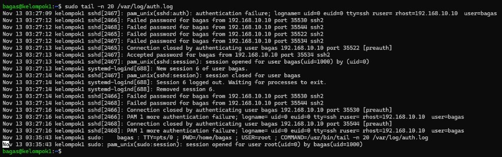
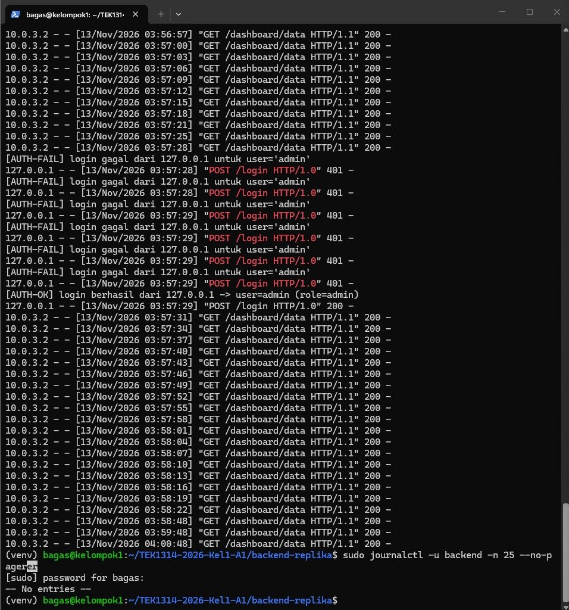
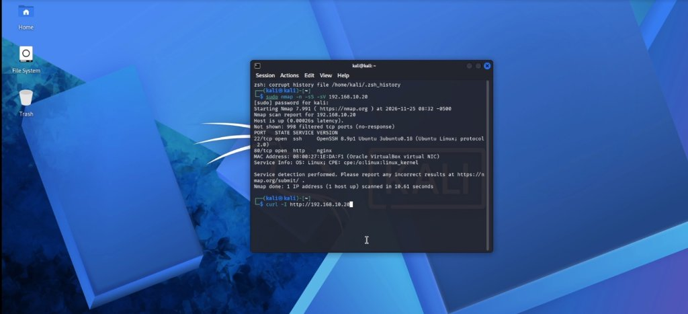
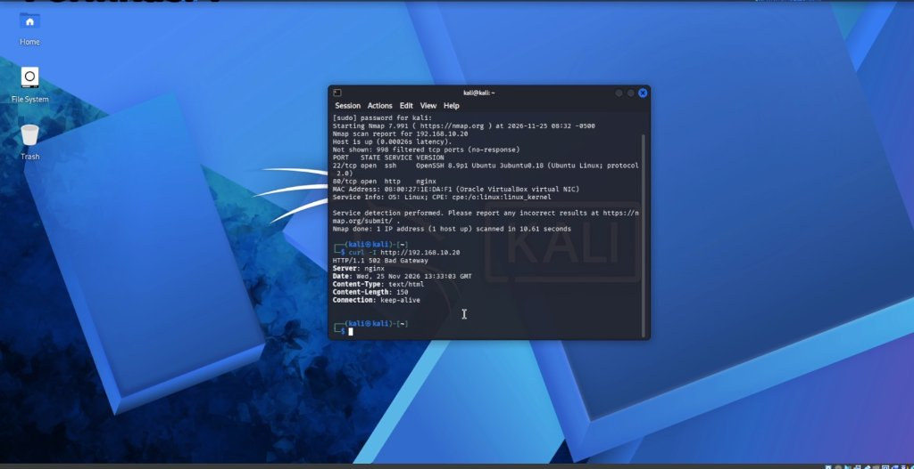
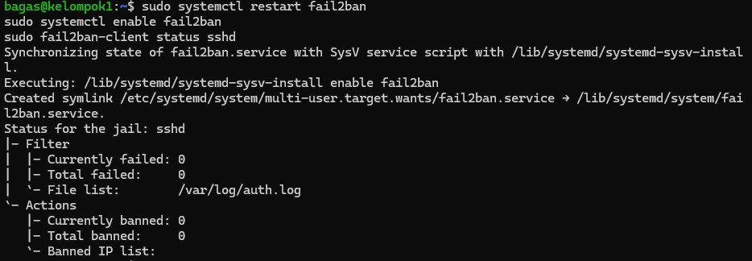
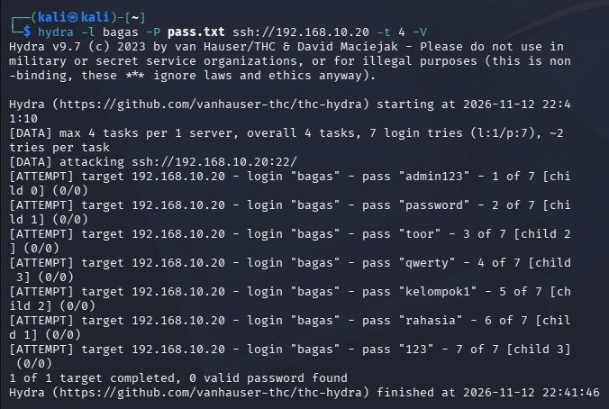
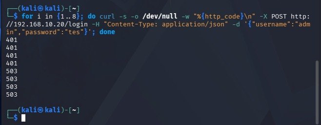

# Direktori Bukti (Evidence) — Blue Team

Folder ini berisi artefak dan tangkapan layar (*screenshot*) hasil deteksi sensor **Security Onion IDS (`192.168.10.30`)**, log forensik pada **Target-Node (`192.168.10.20`)**, serta bukti verifikasi pasca-hardening (*After Hardening*).

---

## A. Bukti Deteksi Awal (Tahap 2 Purple Team Loop — Sebelum Hardening)

### 1. Deteksi Skenario 1 — Network & Service Reconnaissance (`01_sguil_recon_nmap_alert.jpg`)
* **Sensor:** `seconion` (`192.168.10.30`)
* **Source IP:** `192.168.10.10` -> **Destination IP:** `192.168.10.20`
* **Alert ID & Event Message:**
  * `5.1254` — `ET SCAN Nmap Scripting Engine User-Agent Detected` (DPort `80`)
  * `5.1255` — `ET SCAN Possible Nmap User-Agent Observed` (DPort `80`)
  * `5.1266` — `ET SCAN Suspicious inbound to mySQL port 4333` (DPort `4333`)


### 2. Deteksi Skenario 2 — Alert Sguil SSH Brute-Force (`02_sguil_ssh_bruteforce_alert_5_1278.jpg`)
* **Alert ID:** `5.1278` (beserta rangkaian scan `5.1228` s.d. `5.1242`)
* **Source IP:** `192.168.10.10` (`SPort: 35544`) -> **Destination IP:** `192.168.10.20` (`DPort: 22`)
* **Event Message:** `ET SCAN LibSSH Based Frequent SSH Connections Likely Brute Force`


### 3. Deteksi Skenario 2 — Log Forensik `/var/log/auth.log` (`03_target_auth_log_ssh_bruteforce.jpg`)
Perintah: `sudo tail -n 20 /var/log/auth.log`
* Mencatat rentetan `Failed password for bagas from 192.168.10.10` pada berbagai port sumber (`35530`, `35544`, `35522`, `35534`), diikuti oleh `Accepted password for bagas from 192.168.10.10 port 35534 ssh2` saat password lemah (`123`) berhasil ditebak sebelum hardening diterapkan.



### 4. Deteksi Skenario 3 — Log Aplikasi Flask Brute-Force `/login` (`04_target_flask_log_web_bruteforce.jpg`)
* Mencatat rentetan percobaan brute-force login ke endpoint `POST /login`:
  * 6x `[AUTH-FAIL] login gagal dari 127.0.0.1 untuk user='admin'` (`"POST /login HTTP/1.0" 401 -`)
  * Diikuti oleh `[AUTH-OK] login berhasil dari 127.0.0.1 -> user=admin (role=admin)` (`"POST /login HTTP/1.0" 200 -`) sebelum diterapkannya pembatasan laju request (*rate-limiting*) di Nginx.



---

## B. Bukti Verifikasi Pasca-Hardening (Tahap 4 & 5 Purple Team Loop — Sesudah Hardening)

### 5. Verifikasi Skenario 1 — Nmap Scan Ulang Pasca-UFW (`05_after_recon_nmap_only_22_80.jpg`)
Perintah: `sudo nmap -n -sS -sV 192.168.10.20`
* Setelah firewall UFW (`default deny incoming`) diaktifkan, hasil scan Nmap menunjukkan **`998 filtered tcp ports (no-response)`** dan hanya menyisakan port **`22/tcp` (open ssh)** serta **`80/tcp` (open http nginx)**. Port internal `5000/tcp` sudah tidak lagi terlihat.



### 6. Verifikasi Skenario 1 — Penyembunyian Versi Nginx (`06_after_recon_curl_header_nginx_no_version.jpg`)
Perintah: `curl -I http://192.168.10.20`
* Setelah direktif `server_tokens off;` diaktifkan pada Nginx, header HTTP hanya menampilkan **`Server: nginx`** tanpa membocorkan nomor versi Nginx maupun sistem operasi.



### 7. Mitigasi & Verifikasi Skenario 2 — Aktivasi Jail Fail2ban `sshd` (`07_after_ssh_fail2ban_sshd_active.jpg`)
Perintah: `sudo systemctl restart fail2ban`, `sudo systemctl enable fail2ban`, dan `sudo fail2ban-client status sshd`
* Mengonfirmasi layanan `fail2ban` telah aktif dan memantau berkas log `/var/log/auth.log` pada jail `sshd`.



### 8. Verifikasi Skenario 2 — Uji Ulang Serangan Hydra Gagal Menemukan Password (`08_after_ssh_hydra_zero_password_found.jpg`)
Perintah: `hydra -l bagas -P pass.txt ssh://192.168.10.20 -t 4 -V`
* Setelah penerapan kebijakan password kompleks PAM `pwquality` dan `Fail2ban`, serangan ulang Hydra menggunakan wordlist yang sama (`admin123`, `password`, `toor`, `qwerty`, `kelompok1`, `rahasia`, `123`) gagal menembus akun `bagas` (**`1 of 1 target completed, 0 valid password found`**).



### 9. Verifikasi Skenario 3 — Uji Rate-Limiting Nginx pada Endpoint `/login` (`09_after_web_login_ratelimit_401_503.jpg`)
Perintah:
```bash
for i in {1..8}; do curl -s -o /dev/null -w "%{http_code}\n" -X POST http://192.168.10.20/login -H "Content-Type: application/json" -d '{"username":"admin","password":"tes"}'; done
```
* Setelah penerapan `limit_req_zone` (`rate=5r/m`, `burst=3 nodelay`) pada `location /login`, 4 percobaan pertama dijawab dengan **`401`**, dan 4 percobaan berikutnya langsung ditolak oleh Nginx dengan **`503`** (`Service Temporarily Unavailable`).


