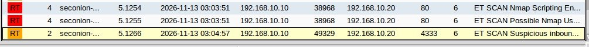
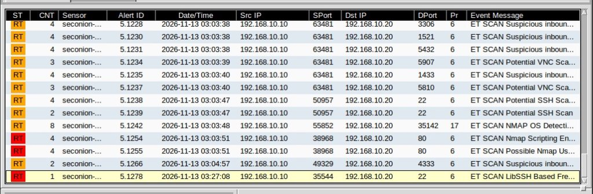

# Direktori Bukti (Evidence) — Blue Team

Folder ini berisi artefak dan tangkapan layar (*screenshot*) hasil deteksi sensor **Security Onion IDS (`192.168.10.30`)** serta log forensik pada **Target-Node (`192.168.10.20`)**.

---

## 1. Deteksi Skenario 1 — Network & Service Reconnaissance

### Alert Sguil untuk Pemindaian Nmap (`01_sguil_recon_nmap_alert.jpg`)
* **Sensor:** `seconion` (`192.168.10.30`)
* **Source IP:** `192.168.10.10` -> **Destination IP:** `192.168.10.20`
* **Alert ID & Event Message:**
  * `5.1254` — `ET SCAN Nmap Scripting Engine User-Agent Detected` (DPort `80`)
  * `5.1255` — `ET SCAN Possible Nmap User-Agent Observed` (DPort `80`)
  * `5.1266` — `ET SCAN Suspicious inbound to mySQL port 4333` (DPort `4333`)

---

## 2. Deteksi Skenario 2 — SSH Credential Brute-Force (Sebelum Hardening)

### a. Alert Sguil untuk Serangan Brute-Force SSH (`02_sguil_ssh_bruteforce_alert_5_1278.jpg`)
* **Alert ID:** `5.1278` ( beserta rangkaian scan `5.1228` s.d. `5.1242`)
* **Source IP:** `192.168.10.10` (`SPort: 35544`) -> **Destination IP:** `192.168.10.20` (`DPort: 22`)
* **Event Message:** `ET SCAN LibSSH Based Frequent SSH Connections Likely Brute Force`

### b. Bukti Forensik `/var/log/auth.log` pada Target-Node (`03_target_auth_log_ssh_bruteforce.jpg`)
Perintah: `sudo tail -n 20 /var/log/auth.log`
* Mencatat rentetan `Failed password for bagas from 192.168.10.10` pada berbagai port sumber (`35530`, `35544`, `35522`, `35534`), diikuti oleh `Accepted password for bagas from 192.168.10.10 port 35534 ssh2` saat password lemah (`123`) berhasil ditebak sebelum hardening diterapkan.

---

## 3. Deteksi Skenario 3 — Web & IoT API Exploitation (Sebelum Rate-Limit Nginx)

### Log Aplikasi Flask pada Target-Node (`04_target_flask_log_web_bruteforce.jpg`)
* Mencatat rentetan percobaan brute-force login ke endpoint `POST /login` yang diteruskan oleh reverse proxy:
  * 6x `[AUTH-FAIL] login gagal dari 127.0.0.1 untuk user='admin'` (`"POST /login HTTP/1.0" 401 -`)
  * Diikuti oleh `[AUTH-OK] login berhasil dari 127.0.0.1 -> user=admin (role=admin)` (`"POST /login HTTP/1.0" 200 -`) karena belum adanya pembatasan laju request (*rate-limiting*) di Nginx.

