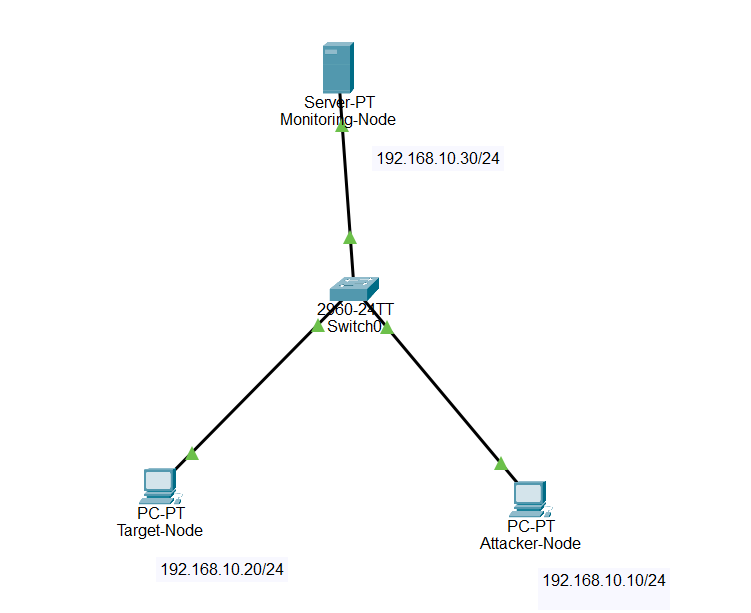

# IP Plan & Deklarasi Arsitektur — Proyek PBL Keamanan Siber (TEK1314)

**Kelompok:** Kelompok 1 (Kelas A1)  
**Proyek IoT Mitra:** GeoSync — Modul Traktor Pertanian Otonom  
**Jaringan Lab Internal:** `intnet-pbl` (`192.168.10.0/24`)

---

## 1. Anggota Tim & Pembagian Peran

| Nama | NIM | Role | Tanggung Jawab Utama |
|---|---|---|---|
| **Tahra Aulia** | J0404241063 | Lead / Coordinator | Koordinasi arsitektur, konsistensi laporan NIST SP 800-61r2, dan manajemen repositori GitHub |
| **Bagas Aditya Putra Rinaldi** | J0404241080 | Blue Team (Defender & Backend) | Pengembangan backend replika GeoSync (Flask + Firebase RTDB), hardening host/aplikasi (Kategori A/B/C), Nginx rate-limit & Fail2ban |
| **Muhammad Raka Faqihhudin** | J0404241159 | Blue Team (SOC & Network) | Konfigurasi sensor Security Onion (`so-import-pcap`, Sguil, Suricata/Snort), analisis paket `tcpdump`, korelasi log |
| **Farrel Naufal Fatih** | J0404241083 | Red Team (Attacker) | Perancangan dan eksekusi skenario serangan (Reconnaissance Nmap, SSH Brute-Force Hydra, Web/API Attack & Verifikasi) |

---

## 2. Topologi Jaringan Lab (`intnet-pbl`)

Seluruh node berada pada jaringan internal terisolasi (`intnet-pbl`) dengan subnet `192.168.10.0/24`. Khusus `Target-Node` memiliki adapter kedua (NAT) pada VirtualBox agar layanan backend replika dapat berkomunikasi secara aman melalui HTTPS menuju **Firebase Realtime Database Cloud**.

---

## 3. Tabel Alokasi IP Address (IP Plan)

| Node | Hostname | Role | IP Address | Subnet | Sistem Operasi | Layanan & Port Aktif |
|---|---|---|---|---|---|---|
| **Attacker-Node** | `kali` | Red Team | `192.168.10.10` | `/24` (`255.255.255.0`) | Kali Linux | Tools: `nmap`, `hydra`, `curl` |
| **Target-Node** | `kelompok1` (`Geosync`) | Target Server (Replika) | `192.168.10.20` | `/24` (`255.255.255.0`) | Ubuntu Server 22.04 LTS | OpenSSH (`22/tcp`), Nginx Reverse Proxy (`80/tcp` -> Flask `127.0.0.1:5000`), Systemd `backend.service` |
| **Monitoring-Node** | `seconion` | Blue Team (IDS / SIEM) | `192.168.10.30` | `/24` (`255.255.255.0`) | Security Onion | Promiscuous interface `eth0`, `tcpdump`, Suricata/Snort IDS, Sguil Console |

---

## 4. Pemetaan Tech Stack Sistem IoT Asli ke Backend Replika

Sesuai prinsip keamanan PBL Minggu 9–15, seluruh pengujian serangan dilakukan terhadap **Target-Node Replika** menggunakan data sintetis/dummy tanpa menyentuh perangkat keras traktor asli milik Mitra.

| Layer / Komponen | Sistem IoT Asli (GeoSync Mitra) | Implementasi Replika Lab (Target-Node `192.168.10.20`) |
|---|---|---|
| **Edge / Sensor Node** | Mikrokontroler ESP32-S3 (C++ Firmware, Sensor Suhu Mesin, RPM, GPS, Fuel, Actuator Crank & Dekompresi) | Simulator klien HTTP REST (`curl` / script telemetri dari node penguji dengan header `X-API-Key`) |
| **Gateway & Application** | NVIDIA Jetson Nano (Linux JetPack Ubuntu-based 64-bit) & Layanan Pengumpul Telemetri | Ubuntu Server (`bagas@kelompok1`), **Nginx Reverse Proxy** (`80/tcp`) + **Python Flask** (`127.0.0.1:5000`, `backend.service`) |
| **Database & Storage** | Cloud NoSQL / Penyimpanan Telemetri & Rute Traktor | **Firebase Realtime Database (NoSQL Cloud)** pada node `/telemetry`, `/commands`, `/routes`, dan `/users` |
| **Web Control Center** | Dashboard Monitoring & Remote Control Traktor | **GeoSync Control Center** (`/login`, `/`, `/dashboard/data`) dengan Role-Based Access Control (`admin` & `user`) |
| **Network Security & Monitoring** | Firewall Gateway & Log Lokal | **UFW Firewall**, **Fail2ban** (`sshd`), **PAM `pwquality`**, **Nginx `limit_req_zone`**, dan **Security Onion IDS (Sguil)** |
