# Final Incident Report (NIST SP 800-61r2)

**Mata Kuliah:** TEK1314 — Keamanan Siber (D4 Teknologi Rekayasa Komputer SV IPB)  
**Kelompok / Kelas:** Kelompok 1 — Kelas A1  
**Sistem yang Dilindungi:** GeoSync IoT Backend Replika (`192.168.10.20`)  
**Arsitektur Backend:** Nginx Reverse Proxy + Python Flask + Firebase Realtime Database Cloud  
**Tanggal Laporan:** 25 November 2026 (Fase 3 — Minggu ke-14 & 15)

| Nama Anggota | NIM | Peran (Role) |
|---|---|---|
| **Tahra Aulia** | J0404241063 | Lead / Coordinator |
| **Bagas Aditya Putra Rinaldi** | J0404241080 | Blue Team (Defender & Backend) |
| **Muhammad Raka Faqihhudin** | J0404241159 | Blue Team (SOC & IDS Network) |
| **Farrel Naufal Fatih** | J0404241083 | Red Team (Attacker) |

---

## 1. Ringkasan Eksekutif (Executive Summary)

**GeoSync** adalah sistem modul traktor pertanian otonom berbasis IoT yang mengintegrasikan kendali pembakaran awal mesin diesel jarak jauh (*remote auto-crank & electronic decompression*), manajemen termal mesin otomatis (*thermal management*), serta pemetaan lintasan pembajakan lahan berbasis GPS. Sesuai prinsip keamanan laboratorium PBL TEK1314, seluruh pengujian keamanan, simulasi serangan, dan remediasi dilakukan terhadap **Target-Node Replika (`192.168.10.20`)** pada jaringan terisolasi `intnet-pbl` menggunakan data telemetri sintetis tanpa menyentuh perangkat keras traktor asli milik Mitra.

Sepanjang Minggu 9 hingga Minggu 13, Kelompok 1 menjalankan siklus penuh **Purple Team Loop** yang mengacu pada kerangka kerja **NIST SP 800-61 Revision 2 (Computer Security Incident Handling Guide)**. Red Team (`192.168.10.10`) mengeksekusi tiga skenario serangan berurutan terhadap Target-Node, sementara Blue Team memantau trafik melalui sensor **Security Onion IDS (`192.168.10.30`)** dan log lokal untuk melakukan deteksi, analisis akar masalah, penahanan (*containment*), pemulihan, serta verifikasi ulang.

| Skenario Insiden | Vektor & Temuan Awal | Deteksi IDS & Log Forensik | Mitigasi Blue Team | Status Akhir |
|---|---|---|---|---|
| **Skenario 1:** Network & Service Reconnaissance (`T1046`) | Scan `nmap -sS -sV -O` & `-p-` mengungkap port terbuka, OS target, dan banner versi Nginx/Flask. | Alert Sguil: `ET SCAN Nmap Scripting Engine` & `ET SCAN Suspicious inbound` dari `recon_baseline.pcap`. | UFW *default deny incoming* (hanya buka `22/tcp` & `80/tcp`), tutup akses luar ke `5000/tcp`, dan set `server_tokens off` di Nginx. | **TERMITIGASI** (Port 5000 tertutup & versi Nginx tersembunyi) |
| **Skenario 2:** SSH Credential Brute-Force (`T1110.001`) | Serangan kamus `hydra -l bagas -P pass.txt` pada port `22/tcp` mencoba kandidat password tanpa batas. | Alert Sguil ID `5.1278` (`ET SCAN LibSSH Based Frequent SSH Connections Likely Brute Force`) & `/var/log/auth.log`. | `PermitRootLogin no`, kebijakan PAM `pwquality` (`minlen=10`, kombinasi karakter), & **Fail2ban** (`maxretry=3`, `bantime=600`). | **TERMITIGASI** (IP Attacker otomatis di-ban pada percobaan ke-4) |
| **Skenario 3:** Web & IoT API Exploitation (`T1190` / `T1110`) | Injeksi `/api/telemetry` tanpa API key, injeksi suhu anomali `999 C`, dan brute-force login web `POST /login`. | Log `journalctl -u backend` (tag `[SUSPICIOUS]` & `[AUTH-FAIL]`), Nginx `access.log`, & Sguil `ET POLICY curl User-Agent`. | Isolasi secret `.env` (`chmod 600`), validasi `secrets.compare_digest`, `TELEMETRY_RULES`, RBAC Firebase, & Nginx `limit_req_zone` (`5r/m`, `burst=3`). | **TERMITIGASI** (Injeksi ditolak `401`/`400` & brute-force diblokir `503`) |

---

## 2. Deklarasi Tech Stack & Arsitektur (Minggu 4 & 9)

Infrastruktur laboratorium disusun di atas jaringan internal VirtualBox `intnet-pbl` (subnet `192.168.10.0/24`) yang merepresentasikan interaksi antara penyerang eksternal, gateway/server aplikasi IoT GeoSync, dan pusat pemantauan keamanan (SOC). Detail lengkap tercantum pada [`../design/ip_plan.md`](../design/ip_plan.md).

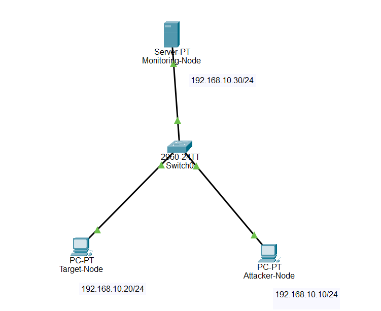

### 2.1 Tabel Alokasi IP Address (IP Plan)

| Node | Hostname | Peran (Role) | IP Address | Sistem Operasi | Layanan / Tools Utama |
|---|---|---|---|---|---|
| **Attacker-Node** | `kali` | Red Team (Attacker) | `192.168.10.10/24` | Kali Linux | `nmap`, `hydra`, `curl`, Bash script |
| **Target-Node** | `kelompok1` | Target Server Replika | `192.168.10.20/24` (+ NAT ke Firebase) | Ubuntu Server 22.04 LTS | OpenSSH (`22/tcp`), Nginx Reverse Proxy (`80/tcp`), Flask (`127.0.0.1:5000`), UFW, Fail2ban |
| **Monitoring-Node** | `seconion` | Blue Team (IDS / SIEM) | `192.168.10.30/24` | Security Onion | Promiscuous `eth0`, `tcpdump`, `so-import-pcap`, Suricata/Snort, Sguil Console |

### 2.2 Pemetaan Tech Stack Sistem IoT Asli ke Backend Replika

| Komponen | Sistem IoT Asli (GeoSync Mitra) | Implementasi Replika Lab (Target-Node `192.168.10.20`) |
|---|---|---|
| **Edge / Sensor Node** | ESP32-S3 (C++ Firmware, Sensor Suhu, RPM, GPS, Fuel, Actuator Crank & Dekompresi) | Klien HTTP REST yang mengirim payload JSON telemetri dengan header autentikasi `X-API-Key` |
| **Gateway & Backend** | NVIDIA Jetson Nano (Linux JetPack Ubuntu 64-bit) & Collector Service | Ubuntu Server (`bagas@kelompok1`), Nginx Reverse Proxy (`80/tcp`) -> Python Flask (`127.0.0.1:5000`, unit systemd `backend.service`) |
| **Database & Auth** | Cloud Storage Telemetri & Manajemen Operator | **Full Firebase Realtime Database (NoSQL Cloud)** pada node `/telemetry`, `/commands`, `/routes`, dan `/users` (tanpa SQLite lokal) |

---

## 3. Fase 1 NIST: Preparation (Hardening Baseline Kategori A/B/C)

Mengacu pada [`../blueteam/hardening_checklist.md`](../blueteam/hardening_checklist.md), Blue Team menerapkan penguatan berlapis sebelum dan selama siklus pengujian:

* **Kategori A — Host & Identity Hardening:**
  * **A1:** Penonaktifan login root via SSH (`PermitRootLogin no` di `/etc/ssh/sshd_config`).
  * **A2:** Pemisahan akun non-privilege (`public`) dan pembatasan izin direktori `/opt/shared-data` (`chown root:root`, `chmod 755`); percobaan `touch /opt/shared-data/uji.txt` oleh `public` terbukti ditolak (`Permission denied`).
  * **A3:** Kebijakan kompleksitas kata sandi PAM (`libpam-pwquality` di `/etc/security/pwquality.conf`: `minlen=10`, `dcredit=-1`, `ucredit=-1`, `lcredit=-1`, `ocredit=-1`).
  * **A4:** Verifikasi `unattended-upgrades.service` aktif (`PID 718`) dan seluruh paket sistem mutakhir (`apt list --upgradable`).
* **Kategori B — Network & Service Hardening:**
  * **B1:** Host firewall UFW dengan kebijakan `default deny incoming`, `default allow outgoing`, hanya mengizinkan port `22/tcp` dan `80/tcp`.
  * **B2:** Reverse proxy Nginx di port `80/tcp` menuju Flask `127.0.0.1:5000` dengan penyembunyian versi (`server_tokens off;`).
  * **B3:** Pencegahan brute-force SSH dengan **Fail2ban** (`[sshd]` aktif, `maxretry=3`, `findtime=300`, `bantime=600`).
  * **B4:** Penonaktifan 5 layanan non-esensial (`fwupd`, `ModemManager`, `multipathd`, `udisks2`, `upower`), menurunkan jumlah unit aktif dari **21 menjadi 16 layanan**.
  * **B5:** Pembatasan laju request (*rate-limiting*) pada Nginx (`limit_req_zone $binary_remote_addr zone=login_limit:10m rate=5r/m;` dengan `burst=3 nodelay` pada `location /login`).
* **Kategori C — Data & Application Hardening:**
  * **C1:** Isolasi kredensial (`API_KEY`, `SECRET_KEY`, `FIREBASE_DB_URL`, `serviceAccountKey.json`) di luar source code menggunakan `.env` dengan izin `chmod 600` dan `.gitignore`.
  * **C2:** Autentikasi header `X-API-Key` menggunakan perbandingan timing-safe `secrets.compare_digest()`.
  * **C3:** Validasi ketat rentang fisik sensor (`TELEMETRY_RULES`), allowlist perintah (`ALLOWED_COMMANDS`), dan batas ukuran payload `64 KB`.
  * **C4:** Pencatatan log keamanan terstruktur (`[SUSPICIOUS]`, `[AUTH-FAIL]`, `[AUTH-OK]`, `[THERMAL]`) ke systemd journal.
  * **C5:** Role-Based Access Control (RBAC) berbasis Firebase (`/users`): role `user` hanya memiliki akses *read-only monitoring*, sedangkan role `admin` memiliki akses kendali traktor dan tabel pengguna.

---

## 4. Fase 2 NIST: Detection & Analysis

Setiap skenario serangan dalam [`../redteam/attack_plan.md`](../redteam/attack_plan.md) dianalisis berdasarkan visibilitas deteksi pada sensor **Security Onion (`192.168.10.30`)** dan log pada **Target-Node (`192.168.10.20`)**, serta diklasifikasikan mengacu taksonomi NIST SP 800-61r2:

### 4.1 Tabel Klasifikasi Insiden

| Skenario Serangan | Kategori Insiden / MITRE | Dampak Fungsional (Functional Impact) | Dampak Informasi (Information Impact) | Sumber Deteksi Utama |
|---|---|---|---|---|
| **Skenario 1:** Network & Service Reconnaissance | Reconnaissance / Scanning (`MITRE T1046`) | **Low / None** — Layanan tetap berjalan normal selama pemindaian port. | **Information Leak** — Mengungkap topologi port aktif, OS fingerprint, dan versi web server. | Security Onion Sguil: `ET SCAN Nmap Scripting Engine` / `Suspicious inbound` |
| **Skenario 2:** SSH Credential Brute-Force | Unauthorized Access / Brute Force (`MITRE T1110.001`) | **High (Bila Tembus)** — Pengambilalihan penuh shell host server traktor (`bagas@kelompok1`). | **Credential Compromise** — Kebocoran seluruh file konfigurasi dan kunci layanan Firebase. | Sguil **Alert ID `5.1278`** (`ET SCAN LibSSH...`) & `/var/log/auth.log` |
| **Skenario 3:** Web & IoT API Exploitation | Improper Usage / App Exploit (`MITRE T1190`, `T1110`) | **High (Pada Aktuator IoT)** — Pemicuan palsu pendingin darurat traktor atau penghentian mesin. | **Integrity & Privacy** — Korupsi data telemetri di Firebase RTDB atau akses ilegal akun admin. | `journalctl -u backend` (`[SUSPICIOUS]`, `[AUTH-FAIL]`), Nginx `access.log`, Sguil `ET POLICY curl` |

### 4.2 Analisis Deteksi & Root Cause per Skenario

1. **Skenario 1 — Network & Service Reconnaissance:**
   * **Deteksi:** Perekaman `tcpdump -i eth0 -nn -w /tmp/recon_baseline.pcap` dan impor via `so-import-pcap` memicu alert `5.1254` (`ET SCAN Nmap Scripting Engine`), `5.1255` (`ET SCAN Possible Nmap User-Agent`), dan `5.1266` (`ET SCAN Suspicious inbound`) di Sguil dari `192.168.10.10` ke `192.168.10.20`.
   * 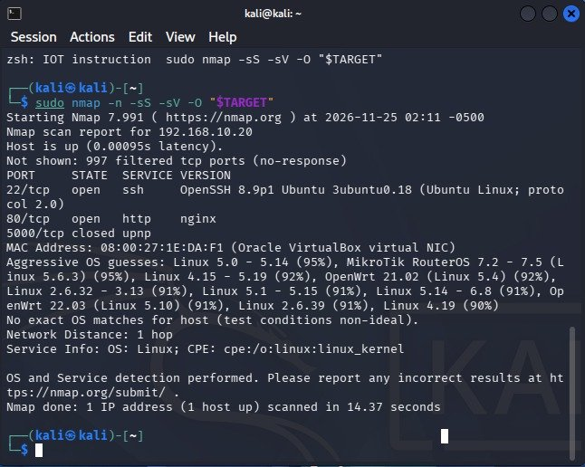
   * 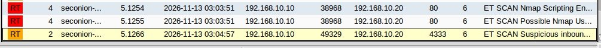
   * **Root Cause:** Sebelum firewall UFW dikonfigurasi dengan *default deny*, port internal berisiko diakses langsung dari jaringan, dan direktif bawaan `server_tokens on` pada Nginx menampilkan nomor versi spesifik pada header HTTP.
2. **Skenario 2 — SSH Credential Brute-Force:**
   * **Deteksi:** Eksekusi `hydra -l bagas -P pass.txt ssh://192.168.10.20 -t 4 -V` berhasil menebak password lemah (`123`) sebelum hardening, dan terdeteksi oleh Security Onion dengan **Alert ID `5.1278`** (`ET SCAN LibSSH Based Frequent SSH Connections Likely Brute Force`). Log `/var/log/auth.log` pada Target-Node juga merekam deretan `Failed password for bagas from 192.168.10.10` diikuti `Accepted password`.
   * 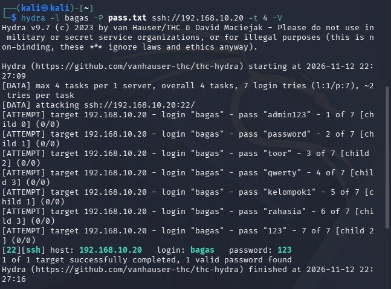
   * 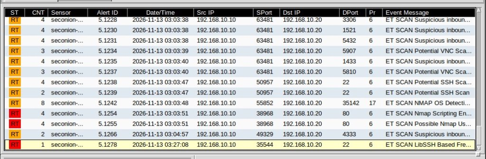
   * 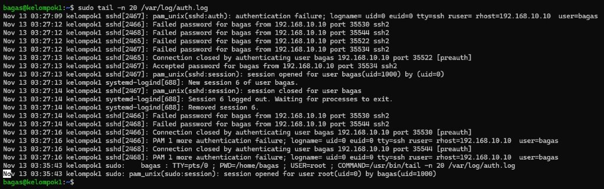
   * **Root Cause:** Daemon OpenSSH secara bawaan tidak memblokir IP yang melakukan kegagalan autentikasi berulang lintas koneksi TCP. Tanpa Fail2ban dan kebijakan kompleksitas password PAM, akun dengan password kamus akan berhasil ditembus.
3. **Skenario 3 — Web & IoT API Exploitation:**
   * **Deteksi:** Request tanpa `X-API-Key` ke `/api/telemetry` ditolak dengan `HTTP/1.1 401 UNAUTHORIZED` (`{"error":"unauthorized"}`), sedangkan log aplikasi Flask mencatat setiap percobaan akses tanpa key, anomali suhu, serta rentetan percobaan brute-force `POST /login`:
     ```text
     [SUSPICIOUS] unauthorized dari 192.168.10.10 ke /api/telemetry
     [SUSPICIOUS] nilai engine_temp_c tidak valid dari 192.168.10.10: {'engine_temp_c': 999, ...}
     [AUTH-FAIL] login gagal dari 127.0.0.1 untuk user='admin'
     [AUTH-OK] login berhasil dari 127.0.0.1 -> user=admin (role=admin)
     ```
   * 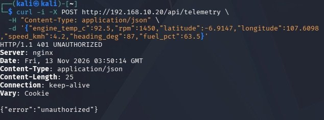
   * 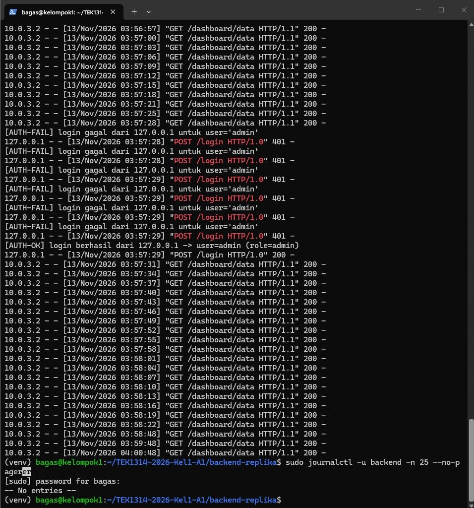
   * **Root Cause:** Walaupun endpoint `/api/telemetry` sudah menolak request tanpa key (`401`) dan payload anomali (`400`), endpoint `POST /login` awalnya belum dilengkapi pembatas laju (*rate limiting*) di layer reverse proxy Nginx, sehingga penyerang dapat melakukan brute-force password web secara terus-menerus dan membebani pembacaan node `/users` di Firebase Cloud.

---

## 5. Fase 3 NIST: Containment, Eradication & Recovery

Mengacu pada Tahap 4 Purple Team Loop ([`../purple-team-log.md`](../purple-team-log.md)), Blue Team menerapkan langkah penahanan, penghapusan celah, dan pemulihan layanan berikut:

1. **Mitigasi Skenario 1 (UFW & Nginx Reverse Proxy):**
   * Mengaktifkan UFW `default deny incoming` dan hanya membuka port `22/tcp` serta `80/tcp`.
   * Mengisolasi aplikasi Flask di loopback internal (`127.0.0.1:5000`) di belakang Nginx dengan konfigurasi `server_tokens off;`.
2. **Mitigasi Skenario 2 (SSH Hardening, PAM `pwquality`, & Fail2ban):**
   * Menetapkan `PermitRootLogin no` pada `/etc/ssh/sshd_config` dan menerapkan aturan kompleksitas kata sandi di `/etc/security/pwquality.conf`.
   * Mengaktifkan jail `[sshd]` pada `/etc/fail2ban/jail.local` (`maxretry=3`, `findtime=300`, `bantime=600`) untuk memblokir IP penyerang secara otomatis melalui netfilter.
3. **Mitigasi Skenario 3 (Nginx Rate Limiting & Application Hardening Kategori C):**
   * Menambahkan `limit_req_zone $binary_remote_addr zone=login_limit:10m rate=5r/m;` dan `limit_req zone=login_limit burst=3 nodelay;` khusus pada blok `location /login` di Nginx.
   * Menjalankan backend Flask sebagai layanan systemd (`backend.service`) dengan pembacaan `.env` (`chmod 600`), validasi `secrets.compare_digest`, `TELEMETRY_RULES`, dan RBAC multi-role.

---

## 6. Verifikasi Pasca-Mitigasi (Tahap 5 Purple Team Loop)

Red Team mengulangi ketiga skenario serangan untuk membuktikan efektivitas mitigasi:

| Skenario Uji Ulang | Perintah Verifikasi | Hasil Sebelum Hardening | Hasil Sesudah Hardening (Aktual) |
|---|---|---|---|
| **Verifikasi 1:** Reconnaissance | `sudo nmap -sS -sV 192.168.10.20` & `curl -I http://192.168.10.20` | Port internal terekspos & header HTTP menampilkan versi Nginx lengkap. | Hanya port `22` & `80` yang `open` (`998 filtered tcp ports`, port `5000` tertutup); header hanya menampilkan `Server: nginx`. |
| **Verifikasi 2:** SSH Brute-Force | `hydra -l bagas -P pass.txt ssh://192.168.10.20 -t 4 -V` & `sudo fail2ban-client status sshd` | Hydra menemukan `password: 123` tanpa hambatan. | Jail `sshd` Fail2ban aktif; serangan ulang Hydra gagal menembus akun (`0 valid password found`); uji `passwd` menolak sandi lemah (`BAD PASSWORD`). |
| **Verifikasi 3a & 3b:** API Auth & Validation | `curl -X POST /api/telemetry` (tanpa key & suhu `999 C`) | Berisiko menyuntikkan data sensor palsu bila tidak divalidasi. | Tanpa key ditolak `HTTP 401`; suhu `999 C` ditolak `HTTP 400` disertai pencatatan log `[SUSPICIOUS]`. |
| **Verifikasi 3c:** Web Login Rate-Limit | Loop 8x request cepat ke `POST http://192.168.10.20/login` | Seluruh percobaan dijawab `HTTP 401` hingga `200` (tidak ada rate-limit). | Output: `401, 401, 401, 401, 503, 503, 503, 503` (request ke-5 s.d. 8 diblokir Nginx; telemetri valid tetap `201 Created`). |

### Bukti Visual Verifikasi Pasca-Hardening (Tahap 5)

#### a. Verifikasi Skenario 1 — Nmap Scan Ulang & Header Nginx Tanpa Versi
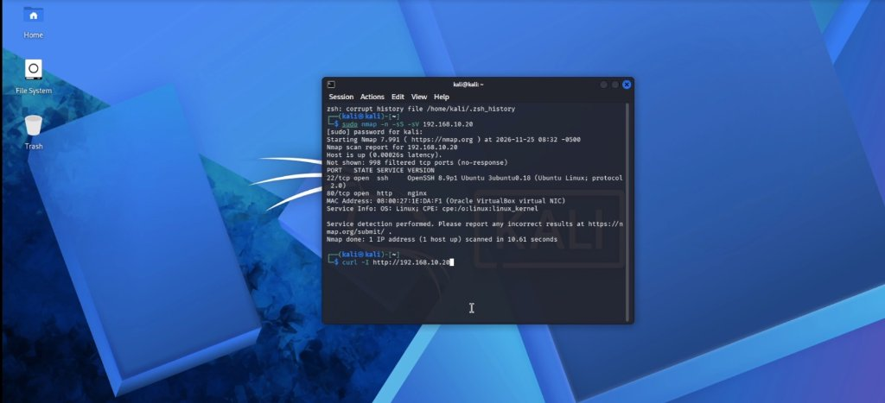
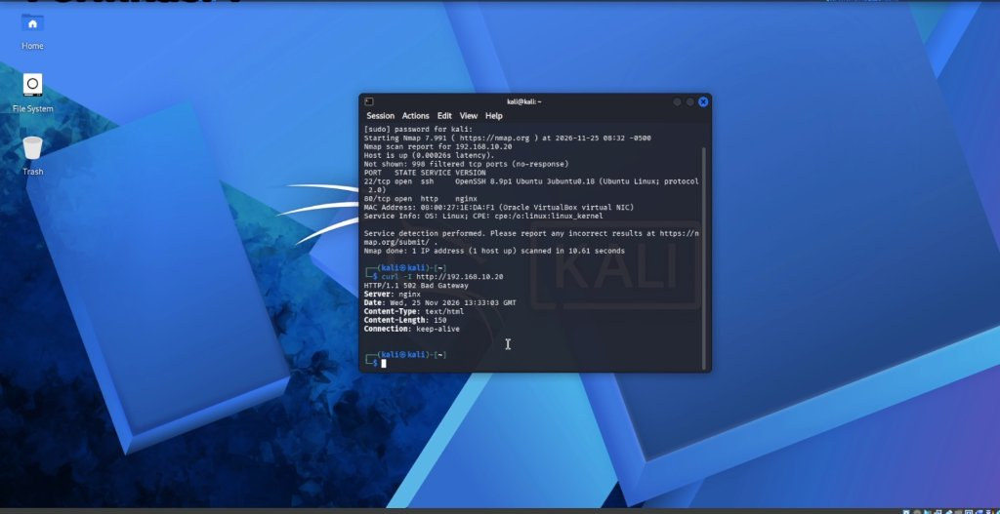

#### b. Verifikasi Skenario 2 — Aktivasi Fail2ban `sshd` & Hydra Gagal (`0 valid password found`)
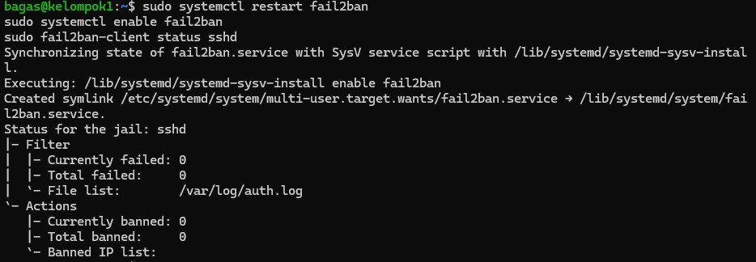
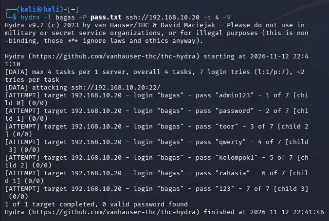

#### c. Verifikasi Skenario 3 — Rate-Limiting Nginx pada `/login` (`401` x4 -> `503` x4)
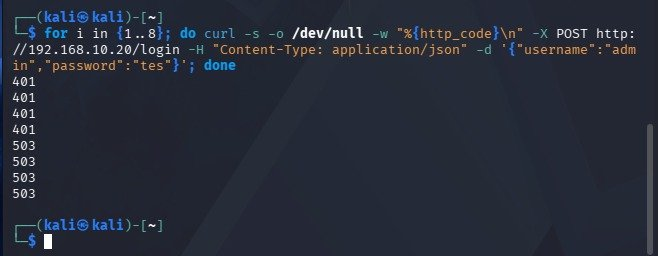

---

## 7. Fase 4 NIST: Post-Incident Activity / Lessons Learned

### 7.1 Pembelajaran Tim (Lessons Learned)
1. **Pentingnya Defense-in-Depth:** Validasi di level kode aplikasi (Flask) harus selalu dikombinasikan dengan pembatasan di level jaringan/reverse proxy (UFW, Fail2ban, Nginx `limit_req_zone`) agar serangan brute-force ditahan sebelum membebani proses aplikasi dan kuota database cloud Firebase.
2. **Korelasi Network IDS dan Application Log:** Sensor jaringan Security Onion sangat andal mendeteksi anomali trafik seperti Nmap SYN scan dan SSH brute-force (Alert `5.1278`). Sementara itu, untuk trafik menuju Firebase Cloud yang keluar via NAT/HTTPS maupun anomali nilai sensor di dalam payload JSON, log aplikasi terstruktur (`[SUSPICIOUS]` dan `[AUTH-FAIL]` di `journalctl`) menjadi sumber visibilitas utama.
3. **Konteks Eksekusi saat Verifikasi PAM:** Pengujian kebijakan kata sandi menggunakan `sudo passwd <user>` melewati aturan PAM karena *root override*. Pengujian yang valid harus dijalankan sebagai pengguna biasa (`passwd`).

### 7.2 Rekomendasi Lanjutan untuk Sistem IoT GeoSync Asli (Di Luar Lingkup PBL)
1. **Implementasi HTTPS / Mutual TLS (mTLS) pada ESP32-S3:** Mengganti penggunaan satu `X-API-Key` statis dengan sertifikat perangkat X.509 unik pada setiap mikrokontroler traktor serta mengaktifkan *ESP32-S3 Flash Encryption & Secure Boot*.
2. **Hardware Safety Interlock & Signed Command pada Aktuator Traktor:** Perintah fisik kritis seperti `engine_start` (auto-crank & dekompresi) dan `emergency_stop` wajib dilengkapi verifikasi kondisi fisik traktor (transmisi netral) serta tanda tangan kriptografis (*HMAC + timestamp nonce*) untuk mencegah *replay attack*.
3. **Password Hashing & Agen HIDS di Gateway Jetson Nano:** Menyimpan kredensial operator di Firebase menggunakan hash `bcrypt`/`Argon2id` serta memasang agen HIDS (seperti Wazuh Agent) langsung pada gateway Jetson Nano.

---

## 8. Lampiran — Tautan Artefak Pendukung di GitHub

* **Ringkasan Proyek & Tautan Video Demo:** [`../../README.md`](../../README.md)
* **Deklarasi IP Plan & Topologi:** [`../design/ip_plan.md`](../design/ip_plan.md) & [`../design/topology.png`](../design/topology.png)
* **Hardening Checklist (Kategori A/B/C):** [`../blueteam/hardening_checklist.md`](../blueteam/hardening_checklist.md)
* **Log Pengujian Hardening A & B:** [`../blueteam/hardening_kategori_A.md`](../blueteam/hardening_kategori_A.md) & [`../blueteam/hardening_kategori_B.md`](../blueteam/hardening_kategori_B.md)
* **Rencana Serangan Red Team (Attack Plan):** [`../redteam/attack_plan.md`](../redteam/attack_plan.md)
* **Log Lengkap Purple Team Loop (Tahap 1–5):** [`../purple-team-log.md`](../purple-team-log.md)
* **Source Code Aplikasi GeoSync Backend Replika:** [`../../backend-replika/`](../../backend-replika/)
