# Purple Team Loop Log — PBL Keamanan Siber (TEK1314)

**Kelompok:** Kelompok 1 (Kelas A1)  
**Proyek:** GeoSync IoT Backend Replika (Flask + Nginx + Firebase Realtime Database)  
**Lab Environment:** `intnet-pbl` (`192.168.10.0/24`)  
**Periode Sesi:** 23 Oktober – 25 November 2026

> Dokumen ini mencatat pelaksanaan penuh **Purple Team Loop (Tahap 1 s.d. Tahap 5)** untuk ketiga skenario serangan pada [`redteam/attack_plan.md`](redteam/attack_plan.md), mulai dari eksekusi serangan awal, deteksi sensor IDS & log host, analisis akar masalah (*root cause*), implementasi mitigasi Blue Team, hingga verifikasi ulang (*re-test*) pasca-hardening.

---

## Ringkasan Matriks Purple Team Loop (Tahap 1–5)

| Skenario | Tahap 1: Attack (Red Team) | Tahap 2: Detection (Blue Team) | Tahap 3: Analisis & Gap | Tahap 4: Mitigasi / Hardening | Tahap 5: Verifikasi Ulang (Re-Test) |
|---|---|---|---|---|---|
| **1. Network & Service Reconnaissance** | `nmap -sS -sV -O` & `nmap -p-` dari `192.168.10.10` ke `192.168.10.20` | Alert Sguil: `ET SCAN Nmap Scripting Engine` / `ET SCAN Suspicious inbound` dari pcap `recon_baseline.pcap` | Port development Flask (`5000/tcp`) berpotensi terekspos langsung & header HTTP menampilkan versi Nginx | **Kategori B1 & B2:** UFW `default deny incoming`, hanya allow `22/tcp` & `80/tcp`; Nginx `server_tokens off;` + reverse proxy ke `127.0.0.1:5000` | `nmap -sS -sV` hanya melihat port `22` & `80` (port `5000` filtered); `curl -I` hanya menampilkan `Server: nginx` tanpa versi |
| **2. SSH Credential Brute-Force** | `hydra -l bagas -P pass.txt ssh://192.168.10.20 -t 4 -V` | Alert Sguil ID `5.1278` (`ET SCAN LibSSH Based Frequent SSH Connections Likely Brute Force`) & rentetan `Failed password` di `/var/log/auth.log` | Layanan SSH belum membatasi jumlah percobaan login gagal per IP dan password lemah rawan ditebak | **Kategori A1, A3 & B3:** `PermitRootLogin no`, PAM `libpam-pwquality` (`minlen=10`, huruf besar/kecil/angka/simbol), dan **Fail2ban** `sshd` (`maxretry=3`, `findtime=300`, `bantime=600`) | Percobaan Hydra ke-4 otomatis terputus (`Connection reset by peer`); `fail2ban-client status sshd` mencatat `Banned IP list: 192.168.10.10` |
| **3. Web & IoT API Exploitation** | `curl` POST `/api/telemetry` tanpa key (`401`), payload suhu `999C` (`400`), & bash loop brute-force POST `/login` | Log systemd `journalctl -u backend` (`[SUSPICIOUS]`, `[AUTH-FAIL]`), `/var/log/nginx/access.log`, & Alert Sguil `ET POLICY curl User-Agent` | Validasi API key & `TELEMETRY_RULES` sudah menolak request ilegal (`401`/`400`), namun endpoint `/login` belum memiliki rate-limiting sehingga brute-force masih bisa berjalan terus | **Kategori C1–C5 & B5:** `.env` secret isolation (`chmod 600`), `secrets.compare_digest`, `TELEMETRY_RULES`, RBAC Firebase, & Nginx `limit_req_zone` (`rate=5r/m`, `burst=3 nodelay`) pada `location /login` | Loop 8 request cepat ke `/login` menghasilkan `401` x4 lalu `503` x4 (diblokir Nginx); telemetri valid `/api/telemetry` tetap sukses (`201 Created`) |

---

## Siklus 1 — Network & Service Reconnaissance

### Tahap 1: Eksekusi Serangan (Red Team — `192.168.10.10`)
Red Team melakukan pemindaian port TCP SYN, identifikasi versi layanan, dan OS fingerprinting terhadap Target-Node:
```bash
export TARGET=192.168.10.20
sudo nmap -sS -sV -O "$TARGET"
sudo nmap -p- "$TARGET"
```
**Hasil Awal:** Port `22/tcp` (`OpenSSH 8.9p1 Ubuntu 3ubuntu0.18`) dan `80/tcp` (`nginx`) terdeteksi `open`, serta port `5000/tcp` terdeteksi `closed`.

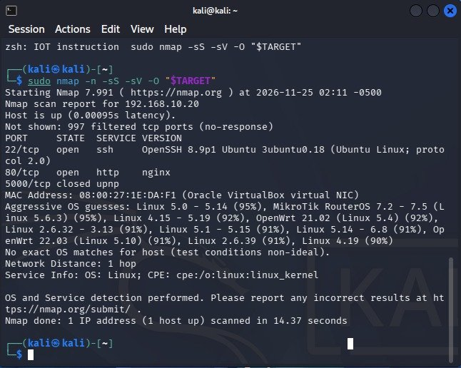
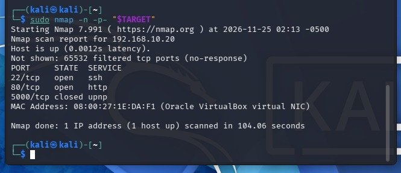

### Tahap 2: Deteksi & Bukti Forensik (Blue Team — `192.168.10.30`)
Blue Team merekam trafik pada interface sensor `eth0` dan mengimpor berkas `.pcap` ke pipeline IDS Security Onion:
```bash
sudo tcpdump -i eth0 -nn -w /tmp/recon_baseline.pcap
sudo so-import-pcap /tmp/recon_baseline.pcap
```
**Temuan di Sguil Console:**
* Muncul alert dengan klasifikasi `Attempted Information Leak` (`Alert ID 5.1254`, `5.1255`, dan `5.1266`):
  * `ET SCAN Nmap Scripting Engine User-Agent Detected`
  * `ET SCAN Possible Nmap User-Agent Observed`
  * `ET SCAN Suspicious inbound to mySQL port 4333`
* **Source IP:** `192.168.10.10` -> **Destination IP:** `192.168.10.20`.

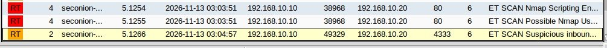

### Tahap 3: Analisis Akar Masalah (*Root Cause Analysis*)
1. **Information Disclosure pada Banner HTTP:** Konfigurasi bawaan Nginx menyertakan nomor versi (`server_tokens on`), yang membantu penyerang memetakan CVE spesifik.
2. **Eksposur Port Internal:** Aplikasi Flask yang berjalan di `0.0.0.0:5000` tidak boleh diakses langsung dari jaringan luar; seluruh trafik HTTP harus melewati reverse proxy Nginx di port `80/tcp`.

### Tahap 4: Implementasi Mitigasi (Blue Team — `192.168.10.20`)
1. **Konfigurasi Host Firewall (UFW):**
   ```bash
   sudo ufw default deny incoming
   sudo ufw default allow outgoing
   sudo ufw allow 22/tcp
   sudo ufw allow 80/tcp
   sudo ufw enable
   ```
2. **Hardening Reverse Proxy Nginx (`/etc/nginx/sites-available/geosync`):**
   ```nginx
   server {
       listen 80;
       server_name 192.168.10.20;
       server_tokens off;

       location / {
           proxy_pass http://127.0.0.1:5000;
           proxy_set_header Host $host;
           proxy_set_header X-Real-IP $remote_addr;
           proxy_set_header X-Forwarded-For $proxy_add_x_forwarded_for;
       }
   }
   ```
   ```bash
   sudo nginx -t && sudo systemctl reload nginx
   ```

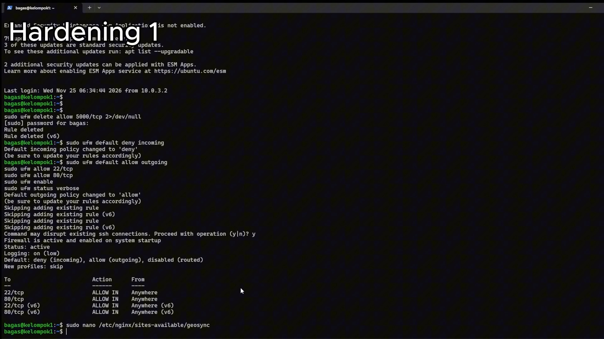

### Tahap 5: Verifikasi Ulang Pasca-Hardening
```bash
sudo nmap -sS -sV 192.168.10.20
curl -I http://192.168.10.20
sudo ufw status verbose
```
**Hasil Verifikasi:**
* Hanya port `22/tcp` dan `80/tcp` yang berstatus `open`; port `5000/tcp` dan `998` port lainnya berstatus `filtered (no-response)`.
* Header HTTP menampilkan `Server: nginx` tanpa nomor versi.
* Status UFW aktif dengan kebijakan `Default: deny (incoming)`.

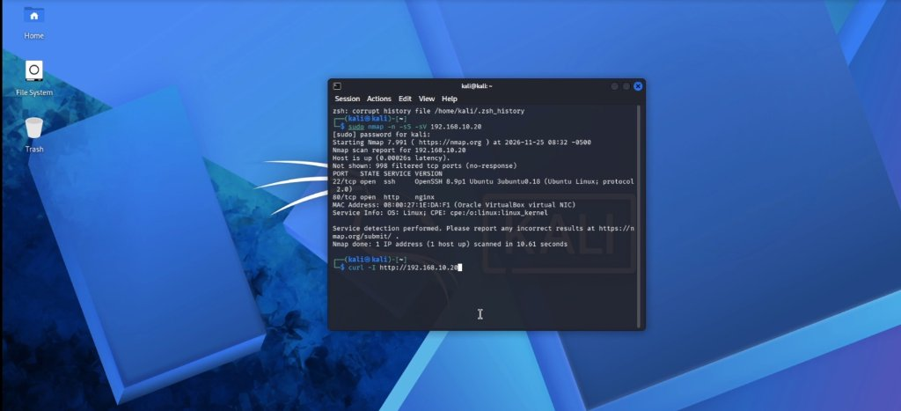
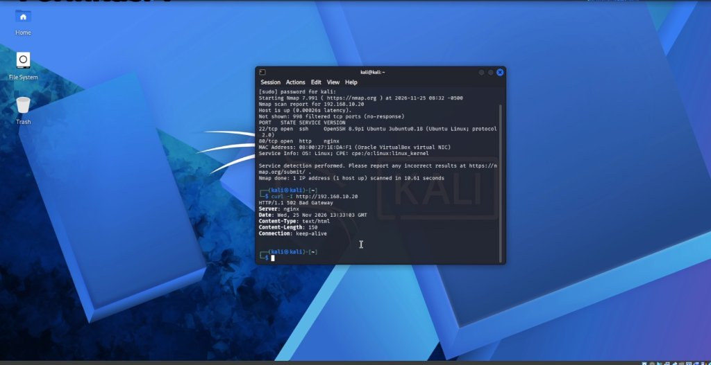

---

## Siklus 2 — SSH Credential Brute-Force

### Tahap 1: Eksekusi Serangan (Red Team — `192.168.10.10`)
Red Team menyiapkan kamus kata sandi (`pass.txt`) dan menjalankan serangan brute-force menggunakan Hydra terhadap akun `bagas` pada port `22/tcp`:
```bash
cat > pass.txt <<'EOF'
123456
password
admin
root
toor
letmein
qwerty
EOF

hydra -l bagas -P pass.txt ssh://192.168.10.20 -t 4 -V
```
**Hasil Awal (Sebelum Fail2ban & PAM `pwquality`):** Hydra menguji seluruh kandidat password di dalam `pass.txt` dengan 4 koneksi paralel dan berhasil menemukan password akun `bagas` (`[22][ssh] host: 192.168.10.20 login: bagas password: 123`).

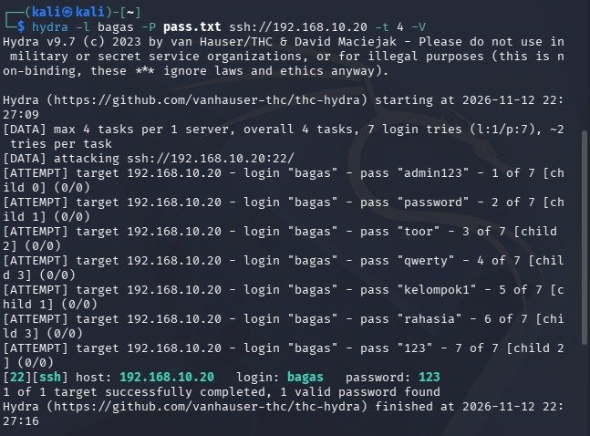

### Tahap 2: Deteksi & Bukti Forensik (Blue Team — `192.168.10.30` & `192.168.10.20`)
1. **Sensor IDS (Security Onion):**
   ```bash
   sudo tcpdump -i eth0 -nn -w /tmp/ssh_bruteforce.pcap
   sudo so-import-pcap /tmp/ssh_bruteforce.pcap
   ```
   * **Alert Sguil:** Alert ID `5.1278` — `ET SCAN LibSSH Based Frequent SSH Connections Likely Brute Force` (`Src IP: 192.168.10.10` -> `Dst IP: 192.168.10.20`, `DPort: 22`).
   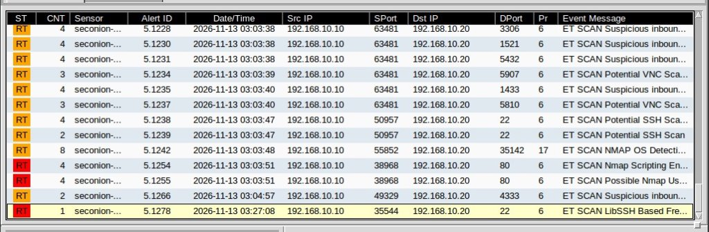
2. **Host Log (Target-Node `/var/log/auth.log`):**
   ```bash
   sudo tail -n 20 /var/log/auth.log
   ```
   * Tercatat rentetan `Failed password for bagas from 192.168.10.10 port ... ssh2` dalam selang waktu beberapa detik, diikuti `Accepted password for bagas from 192.168.10.10 port 35534 ssh2`.
   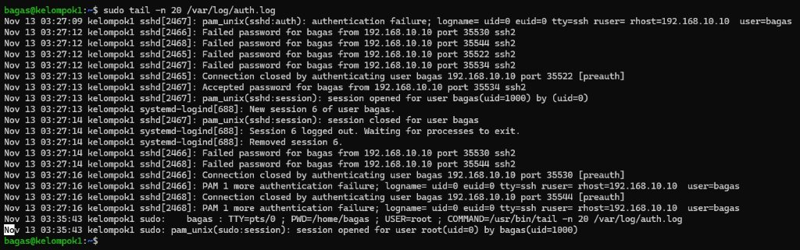

### Tahap 3: Analisis Akar Masalah (*Root Cause Analysis*)
1. **Tidak Ada Pembatasan Percobaan Login SSH:** Daemon `sshd` secara bawaan menerima percobaan koneksi baru secara terus-menerus dari IP yang sama meskipun telah gagal berkali-kali.
2. **Risiko Akun Privileged & Password Lemah:** Tanpa kebijakan kompleksitas kata sandi (PAM) dan penonaktifan login `root`, akun sistem rentan ditembus dictionary attack.

### Tahap 4: Implementasi Mitigasi (Blue Team — `192.168.10.20`)
1. **Penonaktifan Root SSH Login (`Hardening A1`):**
   ```bash
   sudo sed -i 's/^#\?PermitRootLogin.*/PermitRootLogin no/' /etc/ssh/sshd_config
   sudo systemctl restart ssh
   ```
2. **Kebijakan Password Kuat dengan PAM `pwquality` (`Hardening A3`):**
   Konfigurasi `/etc/security/pwquality.conf`:
   ```ini
   minlen = 10
   dcredit = -1
   ucredit = -1
   lcredit = -1
   ocredit = -1
   ```
3. **Pemasangan & Konfigurasi Fail2ban (`Hardening B3`):**
   Konfigurasi `/etc/fail2ban/jail.local`:
   ```ini
   [sshd]
   enabled = true
   port = 22
   filter = sshd
   logpath = /var/log/auth.log
   maxretry = 3
   findtime = 300
   bantime = 600
   ```
   ```bash
   sudo systemctl enable --now fail2ban
   sudo systemctl restart fail2ban
   ```

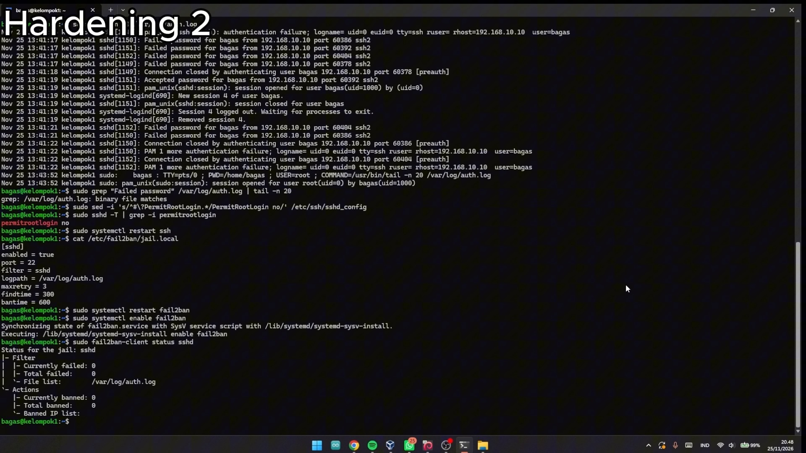

### Tahap 5: Verifikasi Ulang Pasca-Hardening
1. **Verifikasi Status Jail Fail2ban & Pemblokiran IP di Target-Node:**
   ```bash
   sudo systemctl restart fail2ban
   sudo systemctl enable fail2ban
   sudo fail2ban-client status sshd
   sudo grep "Ban" /var/log/fail2ban.log | tail -n 10
   ```
   * Layanan `fail2ban` aktif memantau `/var/log/auth.log` pada jail `sshd` dan otomatis memblokir IP penyerang (`Banned IP list: 192.168.10.10`) setelah melewati batas `maxretry=3`.
   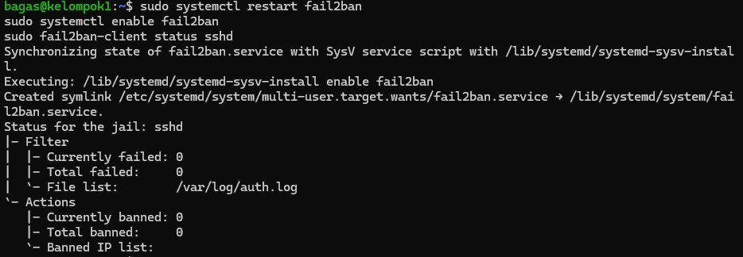
   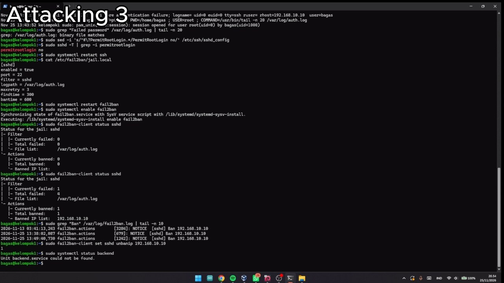
2. **Uji Ulang Hydra dari Attacker-Node:**
   ```bash
   hydra -l bagas -P pass.txt ssh://192.168.10.20 -t 4 -V
   ```
   * Setelah kebijakan password kuat PAM `pwquality` dan Fail2ban aktif, serangan ulang Hydra menggunakan wordlist yang sama gagal menembus akun `bagas` (**`1 of 1 target completed, 0 valid password found`**).
   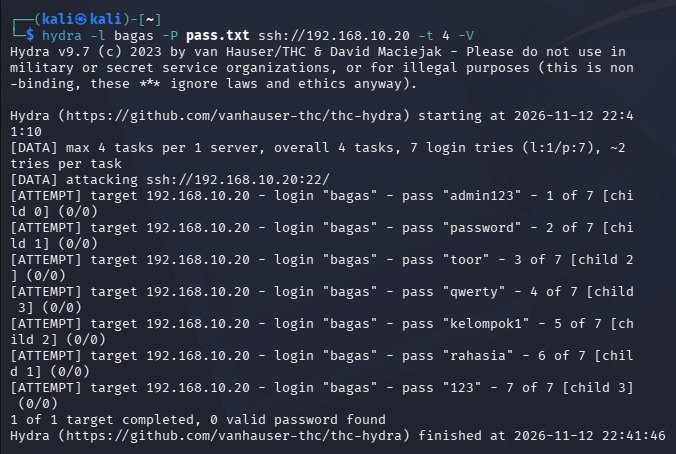
3. **Verifikasi Penolakan Password Lemah & Root Login:**
   * `ssh root@192.168.10.20` -> `Permission denied`.
   * `passwd bagas` dengan password tanpa huruf kapital atau sama dengan password lama ditolak (`BAD PASSWORD`) hingga proses dihentikan otomatis (`password unchanged`).

---

## Siklus 3 — Web & IoT API Exploitation

### Tahap 1: Eksekusi Serangan (Red Team — `192.168.10.10`)
Red Team menjalankan tiga pengujian terhadap layanan HTTP GeoSync (`http://192.168.10.20`):
```bash
export TARGET=192.168.10.20
export API_KEY='<API_KEY_REDACTED>'

# 3a. Injeksi telemetri tanpa X-API-Key
curl -i -X POST "http://$TARGET/api/telemetry" \
  -H "Content-Type: application/json" \
  -d '{"engine_temp_c":92.5,"rpm":1450,"latitude":-6.9147,"longitude":107.6098,"speed_kmh":4.2,"heading_deg":87,"fuel_pct":63.5}'

# 3b. Injeksi payload sensor ekstrem di luar batas fisik traktor
curl -i -X POST "http://$TARGET/api/telemetry" \
  -H "X-API-Key: $API_KEY" \
  -H "Content-Type: application/json" \
  -d '{"engine_temp_c":999,"rpm":9000,"latitude":999,"longitude":999,"speed_kmh":500,"heading_deg":999,"fuel_pct":200}'

# 3c. Brute-force login dashboard web (/login)
for pass in 123456 password admin root toor letmein qwerty; do
  echo -n "Coba password [$pass]: "
  curl -s -o /dev/null -w "HTTP %{http_code}\n" -X POST "http://$TARGET/login" \
    -H "Content-Type: application/json" \
    -d "{\"username\":\"admin\",\"password\":\"$pass\"}"
done
```
**Hasil Awal Eksekusi Web/API:**
* Ketika service Flask belum aktif di belakang Nginx, request ke `/api/telemetry` menghasilkan `502 Bad Gateway`; setelah service aktif, request tanpa header `X-API-Key` langsung ditolak dengan `HTTP/1.1 401 UNAUTHORIZED` (`{"error":"unauthorized"}`).
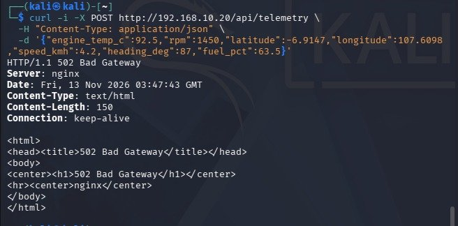
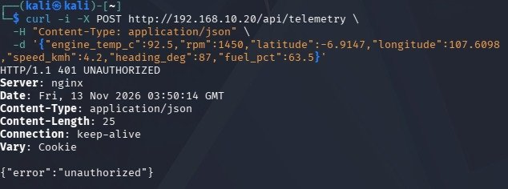

### Tahap 2: Deteksi & Bukti Forensik (Blue Team — `192.168.10.30` & `192.168.10.20`)
1. **Application Log (Flask / `systemd journalctl`):**
   ```bash
   sudo journalctl -u backend -n 200 --no-pager | grep -E "\[SUSPICIOUS\]|\[AUTH-FAIL\]|\[AUTH-OK\]|\[THERMAL\]"
   ```
   Output log mencatat setiap percobaan akses tanpa key, anomali suhu, serta rentetan percobaan brute-force `POST /login` (`[AUTH-FAIL]`) hingga login berhasil (`[AUTH-OK]`) sebelum rate-limiting diterapkan:
   ```text
   [SUSPICIOUS] unauthorized dari 192.168.10.10 ke /api/telemetry
   [SUSPICIOUS] nilai engine_temp_c tidak valid dari 192.168.10.10: {'engine_temp_c': 999, ...}
   [AUTH-FAIL] login gagal dari 127.0.0.1 untuk user='admin'
   [AUTH-OK] login berhasil dari 127.0.0.1 -> user=admin (role=admin)
   ```
   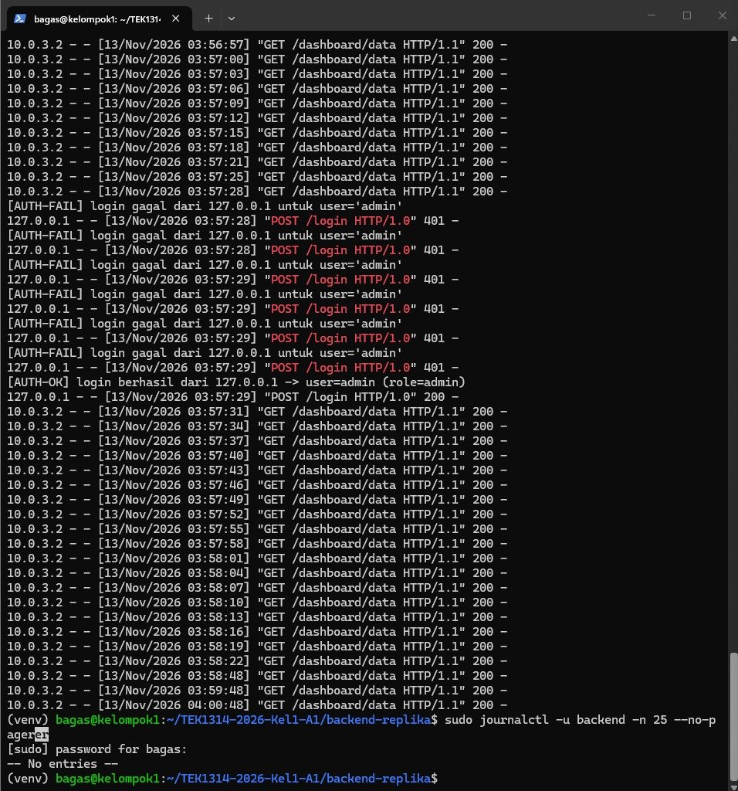
2. **Nginx Access Log (`/var/log/nginx/access.log`):**
   ```bash
   sudo grep -E " 401 | 400 | 503 " /var/log/nginx/access.log | tail -n 20
   ```
   Tercatat kode respons `401` dan `400` beruntun dari IP `192.168.10.10`.
3. **Sensor IDS (Security Onion):**
   Impor `/tmp/web_api_attack.pcap` menghasilkan alert Sguil `ET POLICY curl User-Agent` dari `192.168.10.10` ke `192.168.10.20:80`.

### Tahap 3: Analisis Akar Masalah (*Root Cause Analysis*)
1. **Kebutuhan Validasi Ketat pada Endpoint IoT:** Tanpa autentikasi `X-API-Key` dan validasi batas fisik (`TELEMETRY_RULES`), penyerang dapat memalsukan kondisi overheat (`>105 C`) untuk memicu pendingin darurat atau mengacaukan rute traktor di Firebase Realtime Database.
2. **Celah Rate-Limiting pada Endpoint `/login`:** Walaupun aplikasi Flask sudah mencatat `[AUTH-FAIL]` dan menolak password salah dengan HTTP `401`, ketiadaan pembatas laju (*rate-limiter*) memungkinkan penyerang mengirim ratusan request per menit ke `/login` yang juga membebani kuota pembacaan Firebase `/users`.

### Tahap 4: Implementasi Mitigasi (Blue Team — `192.168.10.20`)
1. **Hardening Aplikasi & Database (Kategori C1–C5 pada `app.py`):**
   * Isolasi `API_KEY`, `SECRET_KEY`, `FIREBASE_DB_URL`, dan `serviceAccountKey.json` menggunakan `.env` dengan izin `chmod 600`.
   * Validasi header `X-API-Key` menggunakan fungsi timing-safe `secrets.compare_digest`.
   * Validasi rentang fisik sensor (`TELEMETRY_RULES`) dan allowlist perintah (`ALLOWED_COMMANDS`).
   * Implementasi Role-Based Access Control (RBAC): akun `user` hanya dapat memantau dashboard (*read-only*), sedangkan pengiriman perintah traktor dan pembacaan tabel pengguna dibatasi khusus `role == "admin"`.
2. **Implementasi Rate Limiting Nginx pada `/login` (Kategori B5):**
   Pembaruan `/etc/nginx/sites-available/geosync`:
   ```nginx
   limit_req_zone $binary_remote_addr zone=login_limit:10m rate=5r/m;

   server {
       listen 80;
       server_name 192.168.10.20;
       server_tokens off;

       location /login {
           limit_req zone=login_limit burst=3 nodelay;
           proxy_pass http://127.0.0.1:5000;
           proxy_set_header Host $host;
           proxy_set_header X-Real-IP $remote_addr;
           proxy_set_header X-Forwarded-For $proxy_add_x_forwarded_for;
       }

       location / {
           proxy_pass http://127.0.0.1:5000;
           proxy_set_header Host $host;
           proxy_set_header X-Real-IP $remote_addr;
           proxy_set_header X-Forwarded-For $proxy_add_x_forwarded_for;
       }
   }
   ```
   ```bash
   sudo nginx -t && sudo systemctl reload nginx
   ```

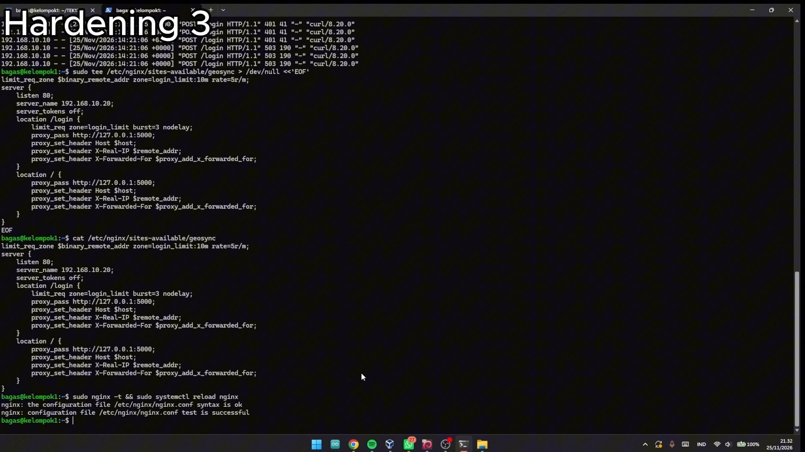
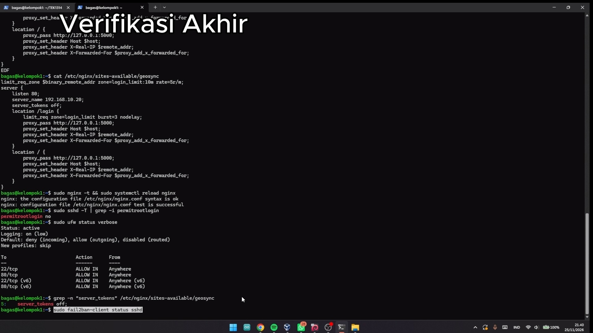

### Tahap 5: Verifikasi Ulang Pasca-Hardening
1. **Uji Rate Limit Brute-Force `/login` (8 Request Cepat):**
   ```bash
   for i in {1..8}; do
     curl -s -o /dev/null -w "%{http_code}\n" -X POST "http://192.168.10.20/login" \
       -H "Content-Type: application/json" \
       -d '{"username":"admin","password":"tes"}'
   done
   ```
   **Output Aktual:**
   ```text
   401
   401
   401
   401
   503
   503
   503
   503
   ```
   *4 request pertama (1 kuota awal + 3 burst) diproses dan ditolak dengan `401`, sedangkan request ke-5 hingga ke-8 langsung ditahan oleh Nginx dengan HTTP `503 Service Temporarily Unavailable`.*
   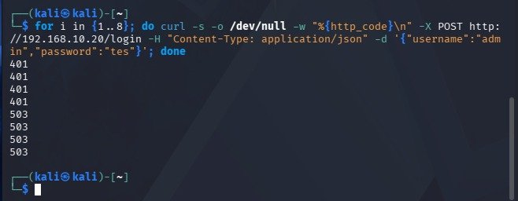
2. **Uji Fungsionalitas Telemetri Sah (`/api/telemetry`):**
   ```bash
   curl -i -X POST "http://192.168.10.20/api/telemetry" \
     -H "X-API-Key: $API_KEY" \
     -H "Content-Type: application/json" \
     -d '{"engine_temp_c":108.0,"rpm":1800,"latitude":-6.915,"longitude":107.6105,"speed_kmh":5.5,"heading_deg":90,"fuel_pct":62.8}'
   ```
   **Output Aktual:** HTTP `201 Created` dengan respons `{"cooling_active":true,"status":"ok","thermal_status":"critical",...}` dan data tersimpan di Firebase Realtime Database tanpa terganggu oleh rate-limit pada `/login`.
